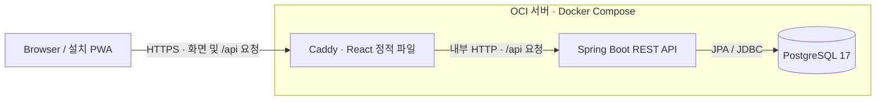
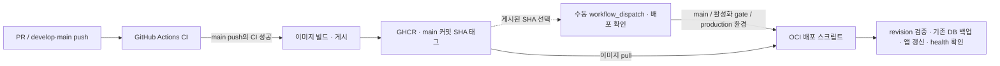

# PartySync

여러 사람이 가능한 시간을 등록하고, 함께 모일 수 있는 시간을 찾는 일정 조율 웹서비스입니다. RPG 게임 파티의 일정 조율에서 출발했으며 소규모 스터디나 모임에도 사용할 수 있습니다.

메신저에서 매번 일정을 다시 묻는 대신 **매주 반복되는 일정과 특정 날짜의 변동을 함께 관리**하고, 시간별 참여 인원과 전원 가능한 시간을 확인합니다. PC에서는 일주일 전체를, 모바일에서는 주간 요약과 선택한 하루를 중심으로 조회하고 수정합니다.

React 클라이언트와 Spring Boot REST API를 PostgreSQL에 연결하고, OCI 서버의 Docker Compose 환경에서 Caddy로 HTTPS와 정적 파일을 제공합니다. 인증·일정 저장·권한 검증은 백엔드에서 처리하며, 세부 설계는 [주요 설계와 의사결정](#주요-설계와-의사결정)에 정리했습니다.

[주요 기능](#주요-기능) · [기술 스택](#기술-스택) · [아키텍처](#시스템-아키텍처) · [설계](#주요-설계와-의사결정) · [검증](#테스트와-품질-검증) · [실행](#로컬-실행) · [한계](#현재-한계와-향후-검토) · [상세 문서](#상세-문서)

## 주요 기능

| 기능 | 동작 |
|---|---|
| 초대 코드·링크 참여 | 파티를 만들고 초대 코드나 링크로 참여합니다. 초대 링크에서 유효한 기존 참여 정보를 확인하면 새 멤버를 만들지 않고 재입장합니다. |
| 비회원 참여와 계정 연결 | 가입 없이 닉네임으로 참여하고, 원할 때 계정에 기존 멤버를 연결합니다. 로그인 유지를 선택하면 인증을 복원하고, 다른 브라우저에서도 계정으로 로그인해 같은 멤버로 입장할 수 있습니다. |
| 반복 일정과 날짜별 예외 | 매주 가능한 시간을 등록하고, 특정 날짜만 다른 일정으로 대체합니다. 예외를 삭제하면 반복 일정으로 돌아갑니다. |
| 참여 현황과 공통 시간 | 시간별 참여 인원, 전원 가능 여부, 내 참여 여부와 멤버별 일정을 확인합니다. 30분 부분 가능 상태와 1시간 전체 가능 상태를 구분합니다. |
| 모바일 일정표 | 7일 요약에 날짜별 최고 참여 인원 비율을 표시하고 하루 상세를 선택합니다. 시간대 접기와 이번 주 추천 시간 TOP 3를 제공합니다. |
| PWA와 기본 파티 | 지원 브라우저에서 홈 화면에 설치할 수 있습니다. 기본 파티를 지정하면 PWA 시작 경로에서 인증과 접근 권한을 확인한 뒤 일정표를 엽니다. |
| 파티 게시판 | 카테고리별 게시글, 페이지 조회, 최신 글 패널을 제공합니다. 작성자는 글을 수정하고 작성자 또는 파티장은 삭제할 수 있습니다. |
| 파티장 권한 | OWNER만 초대 정보를 조회하고 카테고리를 관리하거나 일반 멤버를 강퇴할 수 있습니다. 강퇴해도 기존 일정과 게시글은 보존합니다. |

### PC와 모바일 화면

- **PC(761px 이상)**: 7일 전체 시간표와 최신 글·파티원 패널을 함께 표시합니다. 마우스 드래그로 일정을 수정하며 02:00~08:00는 기본 접힘 상태입니다.
- **모바일(760px 이하)**: 주간 범위 → 7일 요약 → 하루 상세 일정 → 추천 시간 → 최신 글 순서입니다. 요약에는 `4/5`처럼 인원 비율을 표시하며, 새벽·오전·오후·저녁을 개별적으로 접고 펼칩니다. 처음에는 저녁을 펼칩니다.
- 추천 시간을 누르면 해당 날짜와 시간대로 이동합니다. 시간 셀에서는 참여 멤버와 30분별 상세를 확인하고, 수정 모드에서는 탭으로 선택합니다.
- 메인 화면의 `내 파티`는 계정에 연결된 활성 파티와 이 브라우저의 유효한 비회원 참여 정보를 합쳐 표시합니다. 중복 그룹은 계정 멤버 정보를 우선합니다.

설치 PWA의 시작 경로 `/launch`는 로그인 복원 완료를 기다린 뒤 기본 파티의 실제 접근 권한을 검증하고, 필요하면 기존 계정 멤버의 그룹 세션을 재발급합니다. 접근 불가가 확정되면 홈으로 돌아가며 일시적인 서버 장애에는 설정을 보존하고 재시도를 제공합니다. 일반 `/` 접속과 로고 클릭은 자동 입장하지 않고, `/join/:inviteCode`에서는 초대받은 파티를 우선합니다.

## 기술 스택

| 영역 | 기술 | 역할 |
|---|---|---|
| Backend | Java 21, Spring Boot 4.1.2, Spring Web MVC, Bean Validation | REST API, 요청 검증과 공통 오류 응답 |
| 인증·권한 | Spring Security, BCrypt | Bearer 인증 필터, 계정·그룹 권한 검증, 비밀번호 해시 |
| 데이터 접근 | Spring Data JPA, JDBC, Flyway | 도메인 저장과 트랜잭션, 복원 토큰 회전, 버전별 스키마 변경 |
| Database | PostgreSQL 17 | 일정·게시글·계정·인증 세션 영속화, UNIQUE·CHECK·FK 제약 |
| Frontend | React 19.3.1, TypeScript 6, Vite 8.3.8, React Router 7 | SPA, 반응형 일정 편집과 PWA 진입 경로 |
| 클라이언트 상태·스타일 | TanStack Query 5, Tailwind CSS 4, CSS | 서버 데이터 캐시·재조회와 화면 스타일 |
| Infrastructure | OCI Ubuntu, Docker, Docker Compose, Caddy 2 | 단일 서버 컨테이너 운영, HTTPS, 정적 파일과 API 프록시 |
| CI/CD | GitHub Actions, GHCR | 테스트·배포 구성 검증, 이미지 게시, 수동 승인 배포 |
| Testing | JUnit Jupiter, Spring Boot 통합 테스트, Vitest 5, React Testing Library | 도메인·API·DB 정합성·클라이언트 동작 검증 |
| 개발 도구 | Gradle Wrapper 9.8.2, Node.js 24 이상, npm | 빌드와 의존성 관리 |

백엔드 의존성은 [build.gradle](build.gradle), 프론트엔드 버전은 [package.json](frontend/package.json)과 [잠금 파일](frontend/package-lock.json)을 기준으로 합니다.

## 시스템 아키텍처

### 사용자 요청 흐름



Caddy가 React 빌드 파일을 제공하고 같은 Origin의 `/api` 요청을 백엔드로 전달합니다. React Router 경로는 `index.html`로 fallback합니다. 외부에는 Caddy의 80/443 포트만 공개하고 백엔드와 DB는 내부 네트워크에 둡니다. PostgreSQL 데이터와 Caddy 인증서 데이터는 named volume에 보관합니다.

### 검증과 배포 흐름



CI는 백엔드·프론트엔드·배포 구성을 검증합니다. 이미지 게시는 `main` push의 CI 성공 뒤에 실행되며 **이미지 게시가 운영 배포를 실행하지는 않습니다.** 운영 배포는 게시된 40자 커밋 SHA와 확인 입력을 받아 별도로 실행합니다. `production` 환경의 필수 검토자는 저장소 관리자가 설정해야 합니다.

## 주요 설계와 의사결정

### 1. DB 기반 Opaque Token과 계정·그룹 세션 분리

비회원 참여를 유지하면서 계정 연결과 기기별 로그아웃을 지원해야 하므로, 서버에서 유효성을 조회하는 Opaque Token을 사용합니다. HTTP 세션이나 JWT 대신 DB에 토큰의 SHA-256 해시를 저장하고 계정 세션과 그룹 멤버 세션을 구분합니다. 계정 토큰만으로 그룹 일정·게시판에 접근할 수 없으며, 연결된 멤버의 그룹 세션을 발급받아야 합니다.

계정 API 토큰의 기본 수명은 15분입니다. 장기 복원 토큰은 기본 30일의 고정 만료를 가지며, 운영에서 `HttpOnly`·`Secure`·`SameSite=Strict` 쿠키로 전달하고 매 갱신마다 회전합니다. 재사용·만료된 복원 토큰은 해당 기기의 부모·하위 세션을 폐기합니다. 쿠키 변경 요청은 전용 헤더와, Origin이 있으면 동일 Origin 검사를 적용합니다. 클라이언트는 탭 안의 갱신 요청을 공유하고 Web Locks 지원 환경에서는 탭 사이의 회전도 직렬화합니다.

로그인 유지는 기본 선택이며 해제하면 영속 쿠키 대신 세션 쿠키를 사용합니다. 네트워크·5xx 오류만으로 인증 정보를 지우지 않고 재시도를 제공하며, 인증이 검증되기 전에는 로그인 완료로 표시하지 않습니다.

로그아웃은 해당 기기의 계정·하위 그룹 세션을 폐기합니다. 강퇴는 멤버를 비활성화하고 인증·재발급 쿼리가 활성 상태를 확인하여 접근을 차단합니다. JWT의 자체 검증 대신 매 인증 요청의 DB 조회 비용과 세션 데이터 관리 부담을 받아들이는 설계입니다. 비회원 토큰은 복구 수단이 없으므로 `localStorage`에 유지하고 계정 API 토큰은 `sessionStorage`에 분리하지만, **JavaScript로 읽을 수 있는 토큰의 XSS 위험은 남습니다.**

구현: [AccountService](src/main/java/github/partysync/account/AccountService.java), [RememberLoginService](src/main/java/github/partysync/account/RememberLoginService.java), [MemberSessionRepository](src/main/java/github/partysync/account/MemberSessionRepository.java), [계정 인증 복원](frontend/src/features/account/AccountAuth.tsx)

### 2. 반복 일정과 예외의 분리, 서버 집계의 재사용

매주 반복되는 일정 전체를 날짜마다 복제하지 않고, 요일별 반복 일정과 날짜별 예외를 분리합니다. 예외가 있으면 그 날짜의 반복 일정을 완전히 대체하며, **빈 예외는 하루 전체 불가능**, 예외 삭제는 반복 일정 복원을 의미합니다. 일정 날짜와 주간 이동은 `Asia/Seoul`을 기준으로 합니다.

서버는 활성 멤버별 최종 일정을 만든 뒤 하루 48개의 30분 구간에 참여 멤버 ID를 배치합니다. 같은 멤버 구성이 이어지는 구간만 병합하고, 전원 가능 여부는 일정이 없는 활성 멤버까지 포함해 판단합니다. 그룹 일정은 멤버·반복·예외 데이터를 일괄 조회한 뒤 계산하며 날짜별 반복문에서 추가 조회하지 않습니다.

PC와 모바일은 서버 결과에 같은 `summarizeHour()`를 적용합니다. 한 시간의 두 30분 구간 **모두에 포함된 멤버의 교집합**만 전체 가능 인원으로 표시하고, 부분 가능은 별도로 표시합니다. 추천 TOP 3는 0명인 시간을 제외하고 참여 인원 → 전원 가능 여부 → 날짜·시작 시간 순으로 정렬합니다. 별도 추천 API 없이 조회한 주간 데이터를 재사용하며, 현재는 1시간 단위로만 추천합니다.

구현: [AvailabilityCalculator](src/main/java/github/partysync/availability/AvailabilityCalculator.java), [AvailabilityService](src/main/java/github/partysync/availability/AvailabilityService.java), [공통 화면 계산](frontend/src/utils/schedule.ts)

### 3. 트랜잭션과 DB 제약으로 데이터 정합성 유지

그룹 생성과 OWNER 등록은 같은 트랜잭션으로 처리합니다. 초대 코드·토큰 해시의 난수 충돌은 실패한 PostgreSQL 트랜잭션을 재사용하지 않고 새 트랜잭션에서 제한적으로 재시도합니다. 닉네임 중복은 사전 검사로 안내하고 `UNIQUE(group_id, nickname)`이 동시 요청의 최종 중복을 차단합니다. 게시글은 그룹을 포함한 복합 FK로 다른 그룹의 작성자·카테고리가 연결되는 것을 막습니다.

일정은 요청 전체를 검증한 뒤 삭제·삽입을 하나의 트랜잭션에서 수행합니다. 같은 멤버 행의 비관적 잠금으로 일정 쓰기를 직렬화하고 저장 실패 시 기존 데이터도 롤백합니다. 다만 잠금은 오래된 화면의 전체 교체 요청까지 병합하지는 않으므로, 여러 기기의 수정 충돌을 사용자에게 알려주는 기능은 제공하지 않습니다.

강퇴는 `active=false`로 처리합니다. 기존 일정·게시글·계정 연결을 보존하면서 활성 인원과 일정 집계에서 제외합니다. 비활성 멤버의 닉네임도 예약되며, 현재 강퇴 취소와 동일 계정의 재연결은 지원하지 않습니다. 기록 보존과 닉네임 재사용 제한을 함께 선택한 정책입니다.

구현: [GroupService](src/main/java/github/partysync/group/GroupService.java), [AvailabilityService](src/main/java/github/partysync/availability/AvailabilityService.java), [Flyway 마이그레이션](src/main/resources/db/migration), [데이터 모델](docs/erd.md)

### 4. 자동 저장의 요청 순서와 실패 초안 보존

시간 셀마다 PUT을 보내는 대신 `SaveQueue`가 마지막 입력 후 800ms 동안 변경을 모으고 요청을 순서대로 전송합니다. 저장 중 추가 입력은 최신 초안으로 이어서 처리하고, 서버에 저장한 상태와 같으면 중복 PUT과 재조회를 생략합니다. 묶음 저장이 끝나면 그룹 일정·공통 시간 조회를 갱신하며 PUT 성공 뒤 조회만 실패한 경우에는 조회만 재시도합니다.

실패하면 초안을 화면에 유지하고 재시도를 제공합니다. 주간 전체 교체에서도 다른 요일과 수정하지 않은 30분 구간을 보존합니다. 모바일은 스크롤을 수정으로 처리하지 않도록 탭을 사용하고 PC는 드래그 종료 후 저장합니다. 미저장 상태의 주 이동 등을 제한하고 경로 이동은 저장 완료 후 진행하지만, 초안을 디스크에 영속화하지 않으므로 브라우저 강제 종료까지 복구를 보장하지는 않습니다.

구현: [SaveQueue](frontend/src/features/availability/SaveQueue.ts), [AvailabilityWorkspace](frontend/src/features/availability/AvailabilityWorkspace.tsx), [useSlotDrag](frontend/src/hooks/useSlotDrag.ts)

### 5. 격리된 검증과 승인 배포

소형 단일 서버에서 기존 Spring Boot·PostgreSQL 구성을 재사용하며 별도 인증 서버나 캐시 서버를 두지 않습니다. CI는 일회성 PostgreSQL 17 서비스에서 통합 테스트를 수행하고, 배포 Smoke Test도 독립 Compose 프로젝트와 DB를 사용합니다. 로컬 통합 테스트에는 개발 DB 오연결을 막는 접속 대상 검증이 있습니다.

검증된 `main` 커밋으로 백엔드와 프론트엔드·Caddy 이미지를 GHCR에 게시합니다. 승인 배포는 이미지 revision label을 검사하고, 기존 DB에 테이블이 있으면 백업에 성공한 뒤 앱을 갱신합니다. Flyway V1~V5로 스키마 이력을 관리하고 Hibernate는 `ddl-auto: validate`만 수행합니다.

백업 스크립트는 `pg_dump`와 checksum을 생성하고, 복구 검증은 별도 임시 DB에서 수행합니다. 코드 롤백은 DB 마이그레이션 롤백을 뜻하지 않으며, 운영 백업의 외부 보관·정기 실행·실제 복구는 별도 운영 절차가 필요합니다.

구현: [CI](.github/workflows/ci.yml), [이미지 게시](.github/workflows/images.yml), [승인 배포](.github/workflows/deploy.yml), [배포 스크립트](deploy/deploy.sh), [복구 검증](deploy/restore-check.sh)

## 테스트와 품질 검증

| 구분 | 검증 범위 |
|---|---|
| 백엔드 단위 테스트 | 시간 구간 검증·병합, 예외 우선 적용, 참여 인원 계산, 토큰 해시와 제약조건 오류 판별 |
| PostgreSQL 통합 테스트 | 일정 전체 교체·동시 수정, 게시판 권한, UNIQUE·CHECK·FK와 Hibernate 매핑 |
| 인증·권한 | `AccountApiIntegrationTest`의 계정 연결, 세션 만료·로그아웃, 복원 토큰 회전·재사용·Origin 검사, 강퇴 뒤 접근 거부와 기록 보존 |
| 마이그레이션 호환성 | `AccountMigrationTest`가 독립 테스트 스키마에 V2 데이터를 만든 뒤 최신 마이그레이션을 적용해 기존 토큰·일정·게시글 보존 확인 |
| 프론트엔드 | Vitest·React Testing Library와 fetch mock으로 자동 저장 실패·재시도, 모바일 선택·추천·터치, 계정 복원, 홈 파티 병합·기본 파티 실행, PWA 안내 검증 |
| CI·배포 Smoke Test | PR 및 develop/main push에서 백엔드 빌드, 프론트 검사·빌드, 독립 컨테이너의 SPA/API 라우팅·인증·DB 재시작·백업 복구 검증 |

백엔드 전체 검증은 아래 로컬 설정의 **테스트 전용 DB**를 준비한 후 프로젝트 루트에서 실행합니다. API 통합 테스트는 테스트 데이터를 정리하므로 개발·운영 DB를 사용하지 않습니다. 접속 대상 제한과 권한은 [테스트 DB 초기화 코드](src/test/java/github/partysync/support/TestDatabaseInitializer.java)를 참고하세요.

```powershell
.\gradlew.bat clean build
```

DB 없이 실행할 수 있는 단위 테스트 예시입니다.

```powershell
.\gradlew.bat test --tests '*AvailabilityCalculatorTest' --tests '*MinuteRangeTest' --tests '*MemberTokenServiceTest' --tests '*DatabaseConstraintsTest' --tests '*TestDatabaseInitializerTest'
```

프론트엔드는 `frontend`에서 실행하며 테스트 DB가 필요하지 않습니다.

```powershell
npm.cmd run typecheck
npm.cmd run lint
npm.cmd test
npm.cmd run build
```

배포 구성은 Docker Engine·Compose와 Bash를 사용할 수 있는 환경에서 루트의 `node deploy/smoke.mjs`로 검증합니다. 공개 DNS·실제 HTTPS 인증서와 Android/iPhone의 설치 동작은 별도 확인 대상입니다. 이 문서는 테스트 구조와 실행 방법을 설명하며 특정 커밋의 실행 결과를 대신하지 않습니다.

## 로컬 실행

### 1. 개발 환경과 PostgreSQL 준비

Java 21, Node.js 24 이상, PostgreSQL 17과 `psql`을 준비합니다. Gradle은 저장소의 Wrapper를 사용합니다. 로컬 개발 서버 실행에는 Docker가 필수는 아닙니다.

PostgreSQL 관리자 계정으로 `psql -U postgres`에 접속해 아래 예시처럼 개발·테스트용 계정과 DB를 분리합니다. `\password`에서 각 로컬 비밀번호를 입력합니다. 이미 준비된 계정·DB는 다시 만들지 않습니다.

```psql
CREATE ROLE raidsync_local LOGIN;
\password raidsync_local
CREATE DATABASE raidsync OWNER raidsync_local;
CREATE ROLE raidsync_test LOGIN;
\password raidsync_test
CREATE DATABASE raidsync_test OWNER raidsync_test;
\q
```

### 2. 환경 변수 설정

프로젝트 루트의 [.env.example](.env.example)을 `.env`로 복사하고 위 DB의 접속 정보를 입력합니다. 기존 `.env`는 덮어쓰지 않습니다.

| 변수 | 로컬 예시·설정 |
|---|---|
| `DB_URL` | `jdbc:postgresql://localhost:5432/raidsync` |
| `DB_USERNAME`, `DB_PASSWORD` | 개발 DB 계정과 로컬 비밀번호 |
| `TEST_DB_URL` | `jdbc:postgresql://localhost:5432/raidsync_test` |
| `TEST_DB_USERNAME`, `TEST_DB_PASSWORD` | 테스트 전용 계정과 로컬 비밀번호 |
| `CORS_ALLOWED_ORIGINS` | `http://localhost:5173` |
| `AUTH_COOKIE_SECURE` | 로컬 HTTP 개발에서만 `false`, 운영은 기본 `true` |

`.env`는 Git에서 제외됩니다. Spring Boot가 루트 `.env`를 읽으므로 IntelliJ 실행 시에도 작업 디렉터리를 프로젝트 루트로 지정합니다. 테스트 DB는 localhost의 `_test`로 끝나는 이름을 사용해야 하며 개발 DB URL과 같을 수 없습니다.

### 3. 백엔드와 프론트엔드 실행

프로젝트 루트에서 백엔드를 실행합니다. Flyway가 스키마를 적용하고 Hibernate가 매핑을 검증합니다.

```powershell
.\gradlew.bat bootRun
```

별도 터미널에서 프론트엔드를 실행합니다.

```powershell
cd frontend
npm.cmd ci
npm.cmd run dev
```

접속 주소는 **http://localhost:5173**이며 `/api`는 Vite 프록시가 백엔드 기본 포트 `8080`으로 전달합니다. 포트를 바꾸면 [frontend/.env.example](frontend/.env.example)의 `API_PROXY_TARGET`과 허용 Origin을 확인합니다. `VITE_` 변수는 브라우저에 공개되므로 비밀값을 넣지 않습니다.

위 명령은 Windows PowerShell 기준입니다. macOS/Linux에서는 `.\gradlew.bat` 대신 `./gradlew`, `npm.cmd` 대신 `npm`을 사용합니다. 운영 환경 변수와 배포 절차는 [운영 배포 문서](docs/deployment.md)에 분리했습니다.

## 현재 한계와 향후 검토

현재 제공하지 않는 기능과 환경상 제약입니다.

- 비밀번호 복구, 이메일 인증, 소셜 로그인은 지원하지 않습니다.
- 강퇴 취소, 영구 재가입 차단, 초대 링크 재발급, 그룹 삭제와 권한 위임은 지원하지 않습니다. 강퇴된 닉네임과 계정 연결은 보존하며 기존 초대 링크로 다른 닉네임의 새 비회원 참여는 가능합니다.
- 계정에 연결하지 않은 비회원이 토큰을 잃으면 닉네임만으로 복구할 수 없습니다.
- 기본 파티 설정에는 그룹 ID만 `localStorage`에 저장하고 계정 ID별로 구분합니다. 다른 브라우저·설치 PWA의 저장소와 자동 동기화하지 않습니다.
- PWA는 Manifest 기반 설치를 제공하며 Service Worker를 등록하지 않습니다. 오프라인 일정 편집과 푸시 알림은 지원하지 않습니다. 카카오톡 인앱 브라우저에서는 외부 브라우저 안내만 제공하고 강제 전환하지 않습니다.
- 요청 제한은 단일 프로세스 메모리 기준입니다. 다중 서버의 공유 제한 정책과 세션 테이블의 정기 정리 작업은 구현하지 않았습니다. 만료된 복원 토큰만 발급 시 제한적으로 정리합니다.

향후에는 계정 복구 수단, 안전한 강퇴 취소 절차, 여러 기기의 일정 수정 충돌 안내, 모임 시간 확정을 검토할 수 있습니다. 현재 구현 범위에는 포함하지 않습니다.

## 상세 문서

- [API 명세](docs/api.md): 요청·응답, 인증·권한과 오류 코드
- [ERD와 데이터 모델](docs/erd.md): 관계, 제약조건과 마이그레이션
- [운영 배포](docs/deployment.md): Docker·Caddy, 이미지 게시와 승인 배포, 백업·복구·롤백
- [PWA·로그인 유지·강퇴 정책](docs/pwa-and-sessions.md): 설치, 인증 복원, 기본 파티와 기존 데이터 호환성
