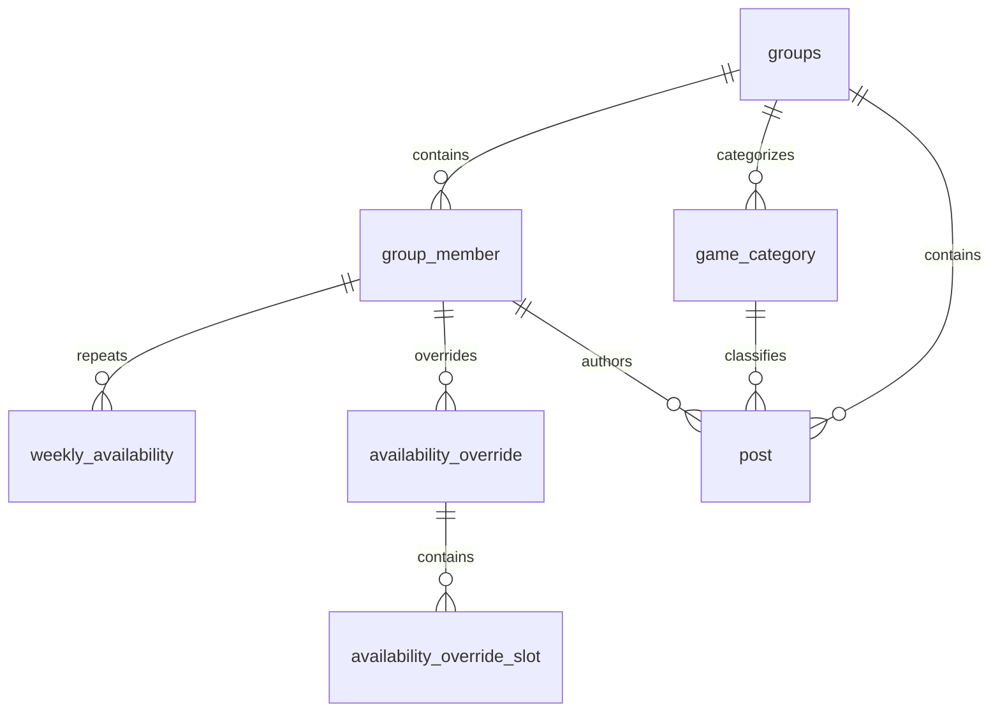

# RaidSync 데이터 모델

스키마의 기준은 [V1 SQL](../src/main/resources/db/migration/V1__init_schema.sql)과 [V2 SQL](../src/main/resources/db/migration/V2__unique_member_token_hash.sql)이다. Hibernate는 validate만 수행하며 DDL을 생성하지 않는다. PK는 모두 BIGINT GENERATED BY DEFAULT AS IDENTITY이고 Java Long이다. 아래 nullable을 제외한 컬럼은 모두 NOT NULL이다.

## 관계

## groups — Group

| 컬럼 | PostgreSQL 타입 | 키 / 의미 |
|---|---|---|
| id | bigint identity | PK |
| name | varchar(100) | 공백 이름 CHECK |
| description | text | nullable |
| invite_code | varchar(128) | UNIQUE, 공백 CHECK |
| created_at | timestamp(6) without time zone | 생성 시각 |
| updated_at | timestamp(6) without time zone | 변경 시각 |

멤버 수는 컬럼 없이 COUNT로 계산한다. 초대 코드는 256비트 난수로 생성하며 인증 토큰과 분리한다.

## group_member — GroupMember

| 컬럼 | PostgreSQL 타입 | 키 / 의미 |
|---|---|---|
| id | bigint identity | PK |
| group_id | bigint | FK → groups.id |
| nickname | varchar(50) | 공백 CHECK |
| role | varchar(16) | CHECK OWNER/MEMBER, Enum STRING |
| access_token_hash | varchar(255) | 해시만 저장, 공백 CHECK |
| joined_at | timestamp(6) without time zone | 참여 시각 |

UNIQUE(group_id, nickname)으로 그룹 안의 중복을 금지한다. UNIQUE(id, group_id)는 게시글의 복합 FK 참조 키다. UNIQUE(access_token_hash)는 인증 토큰이 한 멤버를 식별하도록 보장하고 조회 인덱스로 사용한다. OWNER 존재/개수는 DB 모델에서 강제하지 않으며 그룹 생성 Service가 단일 트랜잭션에서 OWNER를 함께 생성한다.

## weekly_availability — WeeklyAvailability

| 컬럼 | PostgreSQL 타입 | 키 / 의미 |
|---|---|---|
| id | bigint identity | PK |
| group_member_id | bigint | FK → group_member.id |
| day_of_week | varchar(9) | CHECK MONDAY~SUNDAY, java.time.DayOfWeek STRING |
| start_minute | integer | 시작 분 |
| end_minute | integer | 종료 분 |

CHECK(0 <= start_minute AND start_minute < end_minute AND end_minute <= 1440). UNIQUE(group_member_id, day_of_week, start_minute, end_minute)는 정확히 같은 구간의 중복을 방지하고 멤버·요일·시작 분 조회 인덱스로도 사용한다. 시간은 시작을 포함하고 종료를 제외하는 [startMinute,endMinute)이며 1440은 24:00이다. 부분 겹침 검증과 일정 계산 Service는 아직 구현하지 않았다.

## availability_override — AvailabilityOverride

| 컬럼 | PostgreSQL 타입 | 키 / 의미 |
|---|---|---|
| id | bigint identity | PK |
| group_member_id | bigint | FK → group_member.id |
| target_date | date | Asia/Seoul 기준 날짜 |
| created_at | timestamp(6) without time zone | 생성 시각 |

UNIQUE(group_member_id, target_date). 존재 자체가 해당 날짜의 반복 일정을 완전히 대체한다. 슬롯이 0개인 예외도 유효하다.

## availability_override_slot — AvailabilityOverrideSlot

| 컬럼 | PostgreSQL 타입 | 키 / 의미 |
|---|---|---|
| id | bigint identity | PK |
| availability_override_id | bigint | FK → availability_override.id, ON DELETE CASCADE |
| start_minute | integer | 시작 분 |
| end_minute | integer | 종료 분 |

주간 일정과 같은 시간 CHECK. UNIQUE(availability_override_id, start_minute, end_minute). 예외 삭제 시 슬롯 삭제는 DB가 보장한다. ORM에서는 Override의 삭제 전파용 역방향 OneToMany(cascade=REMOVE)와 Hibernate @OnDelete를 함께 사용해 관리 중인 슬롯도 삭제 상태로 전이한다. Slot 생성자는 관계의 양쪽을 동기화하며 컬렉션은 공개하지 않는다. 이 한 관계만 생명주기 관리 목적의 양방향이다.

## game_category — GameCategory

| 컬럼 | PostgreSQL 타입 | 키 / 의미 |
|---|---|---|
| id | bigint identity | PK |
| group_id | bigint | FK → groups.id |
| name | varchar(100) | 공백 CHECK |
| description | text | nullable |
| created_at | timestamp(6) without time zone | 생성 시각 |

UNIQUE(group_id, name), UNIQUE(id, group_id). 단일 단계 분류이며 그룹마다 같은 이름을 사용할 수 있다.

## post — Post

| 컬럼 | PostgreSQL 타입 | 키 / 의미 |
|---|---|---|
| id | bigint identity | PK |
| group_id | bigint | FK → groups.id |
| game_category_id | bigint | 복합 FK의 일부 |
| author_id | bigint | 복합 FK의 일부 |
| title | varchar(200) | 공백 CHECK |
| content | text | nullable, 본문 및 참고 URL 텍스트 |
| created_at | timestamp(6) without time zone | 생성 시각 |
| updated_at | timestamp(6) without time zone | 변경 시각 |

FOREIGN KEY(game_category_id, group_id) → game_category(id, group_id), FOREIGN KEY(author_id, group_id) → group_member(id, group_id). 다른 그룹의 카테고리나 작성자가 연결되는 것을 DB에서도 차단한다.

JPA의 세 ManyToOne은 각 ID 컬럼을 쓰는 단방향 매핑이다. 그룹 일치는 Flyway의 복합 FK가 보장하므로 group_id를 여러 쓰기 가능한 매핑에 중복 선언하지 않는다. 게시글 비즈니스 Service와 API는 아직 제공하지 않는다.

기본 인덱스는 (group_id, created_at DESC, id DESC), (game_category_id, group_id), (author_id, group_id)이다. 각각 그룹 게시글 조회와 FK 참조 확인에 사용한다. 이미지 컬럼/엔티티는 없다.

## 공통 설계 이유와 한계

- 연관관계 주인은 FK 컬럼이 있는 자식이며 모든 ManyToOne은 LAZY다. Override-Slot 삭제 전파 이외에는 역방향 컬렉션이 없다.
- 기본 생성자는 protected이며 공개 생성자와 getter만 제공한다. 연관관계에서 equals/hashCode/toString을 생성하지 않는다.
- created_at/updated_at/joined_at은 JPA Auditing으로 생성한다. 시간은 Asia/Seoul의 LocalDateTime이며 DB 기본값이나 트리거와 이중 관리하지 않는다. 직접 SQL로 쓸 때는 감사 시간도 명시해야 한다.
- 그룹·멤버·카테고리 등은 기본 NO ACTION 삭제 정책으로 사용 중인 데이터의 삭제를 막는다. 그룹 삭제 API는 제공하지 않는다.
- UNIQUE 인덱스가 이미 지원하는 group_id, group_member_id, override_id 접두 조회에는 중복 인덱스를 추가하지 않았다.
- 필수 입력은 NOT NULL, 텍스트 길이 및 공백은 DB와 Bean Validation으로 검사한다. SQL btrim 공백 검사와 Java @NotBlank의 유니코드 공백 판별 범위는 다르므로 API에서 입력 정규화를 통일해야 한다.
- DB는 닉네임과 카테고리 이름의 대소문자를 구별한다. 그룹·멤버 API는 이름과 닉네임을 strip 및 Unicode NFC로 정규화하지만 엔티티·DB가 자동으로 정규화하지는 않는다.
- 그룹 Service는 OWNER 생성·토큰 발급/해시 저장·그룹 권한을 검증한다. 일정 모델의 예외는 반복 일정을 완전히 대체하는 구조이며 실제 날짜별 적용·교집합 계산 API는 아직 없다.

## 마이그레이션과 인증 조회

V1은 테이블·관계·기본 제약조건을 생성한다. V2는 group_member.access_token_hash에 uk_member_token_hash UNIQUE 제약과 그 인덱스를 추가한다. 기존 중복 해시가 있으면 마이그레이션이 거절되며 데이터를 임의 삭제하지 않는다. 토큰은 애플리케이션에서 256비트 난수로 발급하고 SHA-256 hex 64자로 저장한다. 인증은 멤버 ID·그룹 ID·닉네임·역할 projection을 한 번 조회한다.

## 참고

삭제 전파 방식은 [Hibernate ORM 공식 문서](https://docs.jboss.org/hibernate/orm/current/userguide/html_single/Hibernate_User_Guide.html)의 @OnDelete와 cascade 동작을 따른다.
